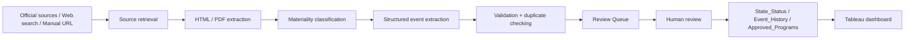

# Workforce Pell State Tracker

A state policy intelligence system for tracking Workforce Pell implementation across the United States.

## What is Workforce Pell?

**Workforce Pell** expands Federal Pell Grant eligibility to certain high-quality, short-term workforce programs. Eligible programs are generally designed to be completed in roughly **8 to under 15 weeks** and must meet additional requirements related to workforce alignment, program quality, completion, job placement, credential value, and state/federal approval. The policy matters because it creates a new federal financing pathway for short-term training while also requiring states, institutions, workforce agencies, and employers to build much stronger approval, data, and accountability systems.


**Official reference:** [U.S. Department of Education — Workforce Pell Grant Final Rule Fact Sheet](https://www.ed.gov/media/document/workforce-pell-grant-final-rule-fact-sheet-114075.pdf)


As of **October 21, 2026**, the tracker records **28 federally approved programs on the public record across 12 institutions in 6 states**. Of those, **21 were announced directly by the U.S. Department of Education** and **7 are documented as federally approved by official state sources**. Three newly state-listed Eastern Iowa Community Colleges records are retained with an additional verification flag because a separate ED announcement has not yet been identified.


<sub>Dashboard snapshot shown above reflects data through October 21, 2026.</sub>

[View the live Tableau Public dashboard here](https://public.tableau.com/app/profile/anruo.wang5635/viz/WorkforcePellGrantStatewideImplementationTracker/Tracker?publish=yes)

## What the tracker answers

- How far has each state progressed in implementing Workforce Pell?
- Which states have opened applications, approved programs, or reached student access?
- Which approvals are state-level versus final federal approvals?
- Which institutions and occupations are represented in approved programs?
- What material implementation events changed a state's status over time?
- Where are data infrastructure, governance, and institutional readiness creating bottlenecks?

## Current architecture

**Visualization:** [Tableau Public](https://public.tableau.com/app/profile/anruo.wang5635/viz/WorkforcePellGrantStatewideImplementationTracker/Tracker?publish=yes)  
**Operational backend:** [Google Sheets](https://docs.google.com/spreadsheets/d/1rhVtZF4VRqX-_yOFa4gCSe73H8bMqkhNPm9U_hHtNrM/edit?usp=sharing)  
**Monitoring:** Python + OpenAI-assisted source discovery/extraction  
**Quality control:** Human review before authoritative state-status changes

This project combines policy research, a structured Google Sheets backend, Tableau visualization, and an AI-assisted human-in-the-loop monitoring workflow. The goal is not only to show **where each state stands**, but also **what changed, what evidence supports the status, which programs are approved, and how implementation capacity differs across states**.

### Monitoring architecture

The monitoring pipeline is designed as a human-in-the-loop system: automation accelerates source discovery, extraction, validation, and deduplication, while authoritative state-status changes remain subject to analyst review.



## Core tables

- `State_Status` — one row per state; authoritative current snapshot
- `Event_History` — one row per material implementation event
- `Approved_Programs` — one row per approved program
- `Review_Queue` — one row per AI/manual candidate awaiting review
- `Capacity_Building` — one row per capacity-building grant or technical-assistance intervention
- `National_Summary` — national headline counts with methodology notes
- `Federal_Guidance` — structured federal implementation guidance

See [`docs/data-model.md`](docs/data-model.md) for details.

## Implementation stages

| Stage | Label | Meaning |
|---|---|---|
| 0 | Not yet reviewed | State has not yet been systematically verified; does **not** mean no activity |
| 1 | Planning / systems build | Governance, data, and implementation systems are being prepared |
| 2 | Framework issued / rulemaking | Formal policy, guidance, or certification framework is public |
| 3 | Applications open | Institutions/programs can submit for state review |
| 4 | Programs approved | At least one program has formal approval; approval level is tracked separately |
| 5 | Operational / student access | Students can actually access Workforce Pell through approved programs |

Important: Stage 4 intentionally includes both state-approved and federally approved programs. Approval level is tracked separately in `Approved_Programs` and related fields.

## Data-quality principles

1. **Unreviewed is not inactive.** Stage 0 is a research-status flag, not a policy-status claim.
2. **State approval ≠ federal approval.** These are recorded separately.
3. **Material event ≠ stage change.** An event can matter without changing the state's stage.
4. **Event date ≠ publication date ≠ detection date.** Date basis is explicitly recorded.
5. **AI never directly overwrites authoritative state status.** Candidate updates go through human review.
6. **Provenance is part of the data model.** State, event, source URL, evidence excerpt, and analyst decision should remain traceable.

## Repository structure

```text
workforce-pell-state-tracker/
├── README.md
├── requirements.txt
├── .env.example
├── .gitignore
├── config/
│   └── states.json
├── docs/
│   ├── methodology.md
│   ├── stage-taxonomy.md
│   ├── data-model.md
│   ├── workflow.md
│   ├── decisions.md
│   ├── monitoring-pipeline.md
│   ├── tableau-build-log.md
│   └── security.md
├── src/
│   ├── __init__.py
│   ├── main.py
│   ├── pipeline.py
│   ├── search.py
│   ├── fetch.py
│   ├── classify.py
│   ├── extract.py
│   ├── validation.py
│   ├── dedupe.py
│   ├── sheets.py
│   ├── state_detection.py
│   ├── taxonomy.py
│   ├── models.py
│   ├── config.py
│   └── logging_config.py
├── tests/
│   ├── __init__.py
│   ├── helpers.py
│   ├── test_dedupe.py
│   ├── test_manual_ingestion.py
│   ├── test_search.py
│   ├── test_sheets.py
│   └── test_validation.py
├── data/
│   └── README.md
├── tableau/
│   └── README.md
└── screenshots/
    ├── README.md
    └── tableau-overview-2026-10-21.jpg
```

## Portfolio framing

> Built a state policy intelligence system for Workforce Pell that combines a structured state-level data model, implementation taxonomy, Tableau visualization, provenance-aware event history, and an AI-assisted human-in-the-loop monitoring pipeline.

## Status

Active project. The live Google Sheets backend and Tableau dashboard continue to be updated as states move through implementation.
