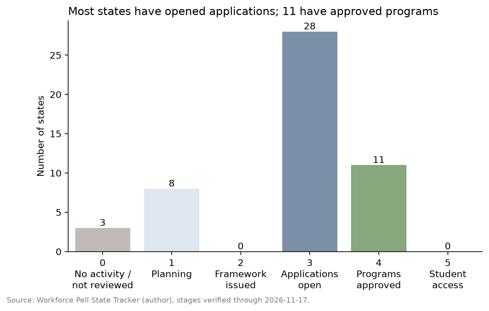
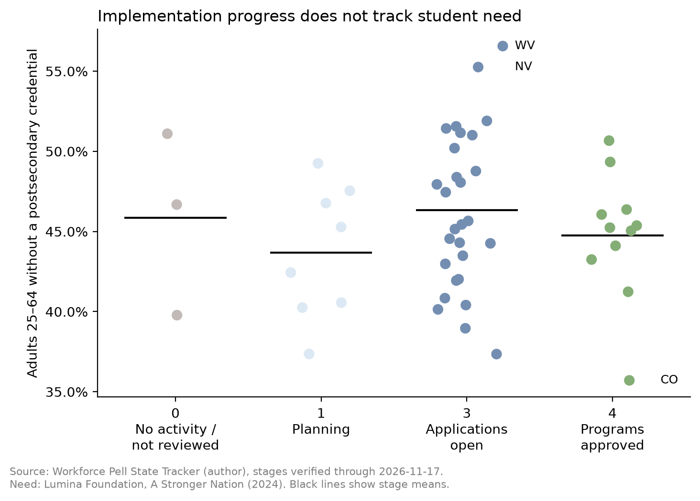
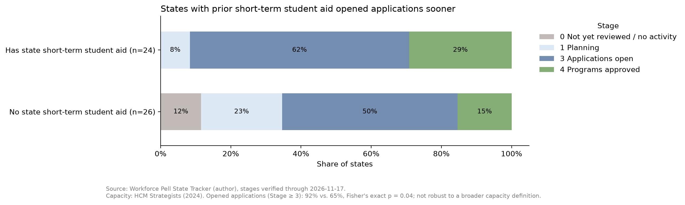
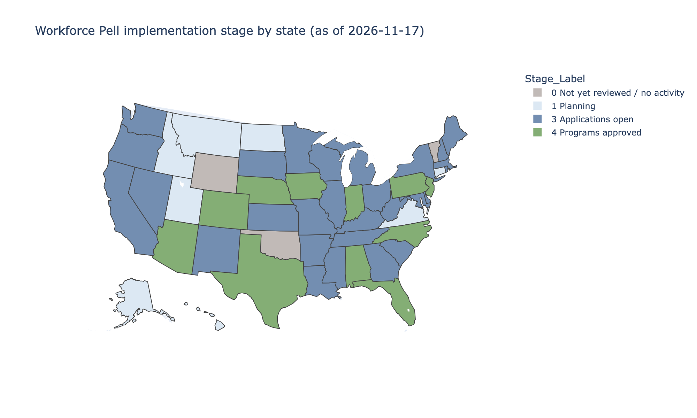

# Capacity or Need? Early Workforce Pell Implementation Across the States

**Research question:** Did states with preexisting short-term workforce infrastructure move further in
early Workforce Pell implementation, and does that progress align with student need?

**Data frozen:** 2026-11-17 · **Author:** Anruo Wang

## Key findings

1. **Most states have opened the door, but few have approved programs.** As of November 17, 2026,
   39 of 50 states had opened applications (Stage 3+), 11 had approved at least one program (Stage 4),
   and none met the evidence standard for confirmed student access (Stage 5).




2. **Progress does not track student need.** Average need is nearly identical across stages
   (43.7%–46.3% of adults without a credential). The two highest-need states, West Virginia (56.6%)
   and Nevada (55.3%), have no approved programs yet.




3. **States with prior short-term student aid opened applications sooner, but the pattern is fragile.**
   92% of states that already funded short-term credential students had opened applications, versus 65%
   of other states (Fisher's exact test, p = 0.04). The gap holds in direction when excluding four
   partial-fit states (p = 0.08) but largely disappears under a broader capacity definition (p = 0.49).




**Bottom line:** Early implementation looks more like a story of capacity than need, specifically
whether a state already directly funded students in short-term programs. This is an exploratory,
descriptive pattern to monitor, not a causal finding.



## Data

| Measure | Definition | Source |
|---|---|---|
| Implementation stage | 0–5 maturity scale (see below) | This repository's state tracker, verified through 2026-11-17 |
| Capacity | State already funded *students* in short-term credential programs (1 = yes; 24 states) | HCM Strategists (2024), *A 2024 Update of State Investments in Short-term Credential Pathways* |
| Need | Share of adults 25–64 without any postsecondary credential (1 − attainment) | Lumina Foundation, *A Stronger Nation* (2024 data) |

### Implementation stages

| Stage | Meaning |
|---|---|
| 0 | Not yet reviewed, or reviewed with no public activity found |
| 1 | Planning / systems build |
| 2 | Framework issued; applications not yet open |
| 3 | Applications open |
| 4 | At least one program formally approved (state and/or federal) |
| 5 | Students can enroll using Workforce Pell, confirmed by the institution or an official source |

Coding rule: conditional or board-level approvals without final action count as Stage 3
(e.g., Michigan, Georgia).

## Methods

- **Figure 1** counts states by stage. **Figure 2** plots each state's need by stage (strip plot with
  jitter; black lines show stage means). **Figure 3** compares stage distributions by capacity group.
- **Fisher's exact tests** compare capacity groups on two binary outcomes: opened applications
  (Stage ≥ 3) and approved programs (Stage ≥ 4). Fisher's test suits small samples with sparse cells.
- **Robustness checks** repeat the tests with (a) any state short-term initiative and (b) excluding four
  states whose programs only partially fit HCM's definition (AR, KY, MN, NV).

## Limitations

- Descriptive, not causal; capacity may proxy for administrative resources or state size.
- Small numbers (50 states); one or two states can shift group percentages.
- Exploratory tests: thresholds were chosen after inspecting the data, and both tests are reported.
- Early snapshot; many state decisions are scheduled for early 2027.
- About 23 states' stages rely on third-party trackers rather than official sources.
- The capacity measure predates Workforce Pell (2024).

## Reproduce

```bash
pip install -r requirements.txt
```

Run `notebooks/01_build_state_panel.ipynb`, then `notebooks/02_figures_and_tests.ipynb`.